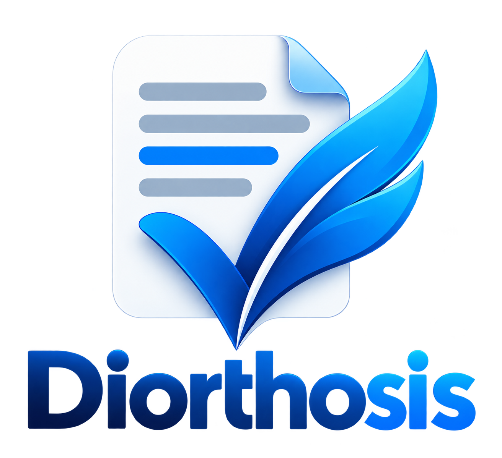

<a id="readme-top"></a>

<div align="center">

  

  <h1 align="center">Diorthosis</h1>

  <p align="center">
    <strong>An offline, privacy-first writing assistant for Dutch and English.</strong>
  </p>

</div>

Diorthosis aims to help people confidently review spelling, grammar, and sentence structure in documents without uploading confidential content to a cloud service.

> **Project status:** Ministral 3B, 8B and 14B GGUFs have executed locally on macOS ARM64 with the CPU-only Native AOT CLI. On the same provisional 44-case diagnostic set, the larger models did not improve Dutch and English correction together; all three remain below the targets. This set is not held-out quality evidence. The 600-case synthetic review candidate still needs independent review. Document processing remains out of scope.

## Project goals

- Run entirely on the user's own computer, with no network access or telemetry.
- Support Windows, macOS, and Linux, with portable, platform-specific releases.
- Require no separate installation of Java, Python, .NET, Docker, Ollama, or an AI runtime.
- Check Dutch and English, with a manually selectable language.
- Read `.txt`, `.docx`, and `.doc`. Produce reviewable suggestions; preserve originals and document formatting wherever verifiably supported.
- Use open-source components and AI models whose terms permit commercial use and redistribution.
- Use only European-origin AI models, excluding models originating in China or Russia.
- Target at least **90%** correct repairs per language, with an aspirational final goal of **95%**, while requiring strict precision, correct-text preservation, and reviewed semantic safety.

## Proposed architecture

A shared C# command-line application is the starting point to evaluate. A pluggable local inference engine and an independently tested document-processing layer keep model selection and file-format support replaceable.

See [architecture](docs/architecture.md), [benchmarks](docs/benchmarks.md), [roadmap](docs/roadmap.md), and the [model quality stop/go decision](docs/decisions/0005-model-quality-stop-go.md).

Local text correction uses pinned LLamaSharp 0.27.0 with an in-process CPU backend. Publish a self-contained CLI and provide an explicit local GGUF path:

```sh
dotnet publish src/Diorthosis.Cli -c Release -r osx-arm64
./src/Diorthosis.Cli/bin/Release/net10.0/osx-arm64/publish/Diorthosis.Cli correct-text --language nl --model /path/to/model.gguf --text "Ik heb het document verstuurt." --json
```

The application never downloads models. Both candidates were executed locally as Q4_K_M on macOS ARM64; neither is quality-approved. The exact revisions, conversion recipe, original and pipeline-corrected smoke results, and limitations are in [model validation](docs/model-validation.md) and the [benchmark pipeline investigation](docs/benchmark-pipeline-investigation.md). Benchmark datasets and commands are in [benchmarks](docs/benchmarks.md).

## Document workflows (not implemented yet)

```console
# Document ingestion and export are a later phase.
```

## Contributing

Read [AGENTS.md](AGENTS.md) before proposing design or code changes. Significant architecture choices must be recorded under `docs/decisions/`. Contributions must not introduce network dependencies or unapproved licensing requirements.

## License

The original code and project documentation in this repository are intended to be published under **Apache License 2.0**, see [LICENSE](LICENSE). Dependencies, third-party data, model weights, and dictionaries retain their own licenses and require independent approval and notices before redistribution. No AI-model weights are bundled in this starter repository.
